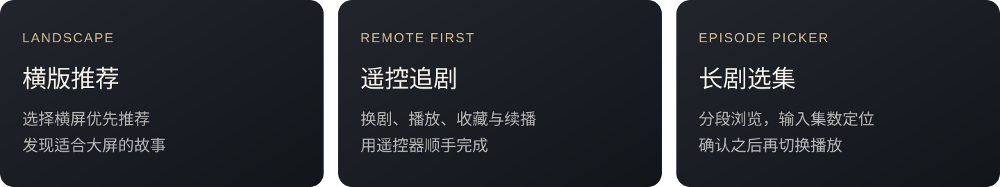
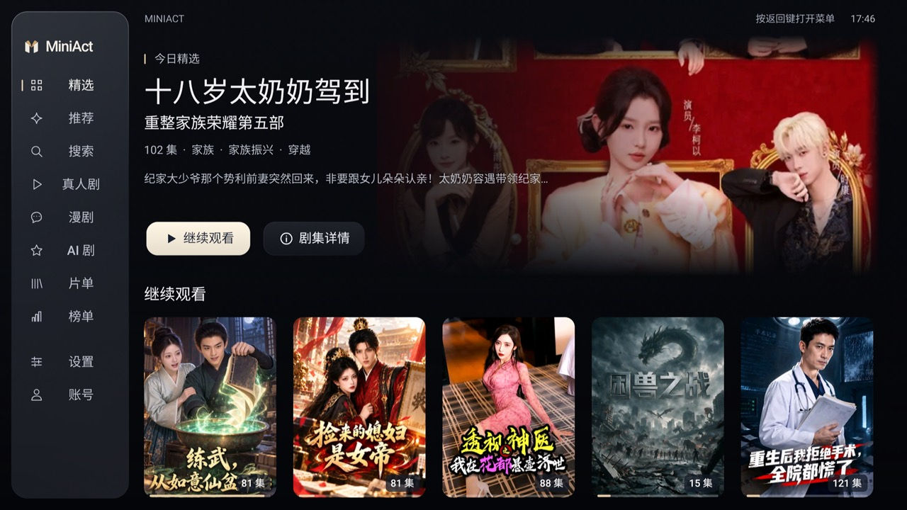
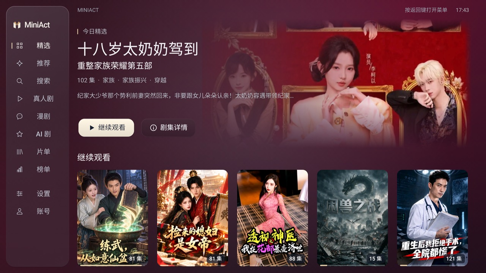
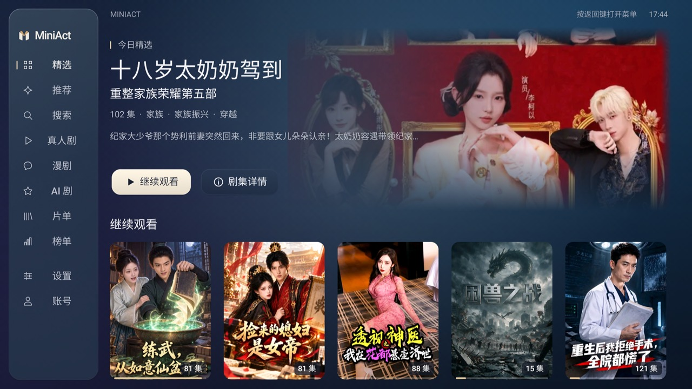

  

  

  为电视大屏与遥控器设计的第三方红果短剧客户端。 
  <b>选择横屏优先推荐，发现更适合大屏观看的故事。</b>

  <a href="#界面一览">界面一览</a> ·
  <a href="#下载与安装">下载与安装</a> ·
  <a href="#遥控操作">遥控操作</a> ·
  <a href="#参与反馈">参与反馈</a>

> 当前版本：**1.2.9.1（67）· 预览版**。首页图取自 11 月 2 日实机记录，选集图取自 11 月 3 日记录；各项验证范围见[验证记录](docs/miniact/VALIDATION.md)。

## 适合大屏，也顺手

支持横屏优先推荐；默认进入精选主页，也可选择推荐视频作为启动页。看过的剧接着看，喜欢的剧收藏起来。应用内无广告。

## 界面一览

### 从精选出发

精选大图、继续观看和常用栏目集中呈现。上图用于展示首页布局；横版视频推荐的专属实录后续补充。

### 很多集，也能快速找到

| 分段浏览 | 输入集数定位 |
| :---: | :---: |
|  |  |
| 先选范围，再进入具体页 | 定位之后，确认集数才播放 |

<b>再看看两种主题</b>

| 酒红丝绒 | 深海蓝 |
| :---: | :---: |
|  |  |

另有影院深色与琥珀棕，主题选择可保存。

截图来源与验证边界见[截图说明](docs/screenshots/README.md)。剧照、封面和视频内容归各自权利人。

## 下载与安装

从 [Releases 下载 MiniAct APK](https://github.com/xy6176/miniact-tv/releases)，通过电视支持的安装器安装。完整步骤见[安装与使用](docs/miniact/USER_GUIDE.md)。

适用于 Android 电视、盒子和投影设备。非 Android 电视系统不能直接安装 APK。同包名、同签名且版本满足要求时，可覆盖安装并保留本机数据；开发包与正式包可能使用不同签名。

| 系统 / 设备 | 当前验证范围 |
| --- | --- |
| Vidda X2026 · Android 11 | 主要流程及部分长剧选集已有实机验证 |
| TCL · Android 9 | 有此前安装与启动记录；最新选集版待验证 |
| Android 4.4 / API 19 | 工程声明的最低系统；待补齐完整实测 |
| 其他设备 | 播放取决于系统解码器及实际媒体编码 |

全局焦点路径、长剧末页和部分输入边界仍需补齐真机回归。平台接口变化也可能影响内容和账号功能。

## 遥控操作

| 操作 | 推荐视频 | 正式播放 |
| --- | --- | --- |
| 上 / 下 | 上一部 / 下一部 | 上一集 / 下一集 |
| 确认 | 进入正式追剧 | 暂停 / 继续 |
| 左 / 右 | 按当前页面及绑定操作 | 快退 / 快进 |
| 长按确认 | 按当前页面及绑定操作 | 打开播放选项 |
| 返回 | 按当前层级返回 | 按当前层级返回 |

以上为默认绑定，部分按键可在应用内调整。

## 参与反馈

欢迎反馈安装兼容、遥控焦点、横版推荐、选集和播放问题。请提供 **设备型号、系统版本、MiniAct 版本、操作步骤与实际现象**。

通过 [Issues](https://github.com/xy6176/miniact-tv/issues) 提交问题，参与方式见[贡献指南](CONTRIBUTING.md)。不要上传手机号、验证码、登录二维码、Cookie、Token、会话备份或未经检查的完整日志。

<b>开发与构建</b>

使用 Kotlin、Android 原生界面、RecyclerView 与 Media3。构建需要 JDK 17、Android SDK 36 和项目自带 Gradle Wrapper。

| 目录 | 职责 |
| --- | --- |
| `android/app` | 电视界面、焦点、本机数据和播放器 |
| `android/core` | 内容访问、账号请求与核心逻辑 |
| `docs` | 安装、使用、兼容性、隐私和架构文档 |
| `tools` | 构建及维护工具 |

当前构建为 `1.2.9.1 / 67`。仓库根目录运行 `bash tools/build-miniact.sh`，脚本会设置正确版本并构建开发包。完整命令与签名说明见[构建文档](docs/miniact/BUILD.md)。

<b>数据与账号</b>

内容与账号请求会访问对应平台。登录凭据、设备档案、本机历史与偏好保存在本应用数据目录；当前会话镜像仅使用私有目录，不等于专门加密存储。

卸载、清除数据或更换设备可能丢失本机数据。账号收藏同步与本机历史备份是不同机制。

## 许可

应用源码沿用 **GPL-3.0-only**，保留原作者与第三方归属。发布安装包同时提供对应源码和构建说明。详见 [LICENSE](LICENSE)、[NOTICE](NOTICE.md) 和[来源记录](docs/miniact/PROVENANCE.md)。

MiniAct 为第三方项目，与红果短剧及相关品牌官方无关联。代码许可不涵盖平台内容、接口和商标授权。

## 感谢

- [HGTV](https://github.com/pan8664716/HGTV)：提供代码基础、内容接入、协议及原生播放能力；MiniAct 在此基础上改进电视界面、焦点导航、收藏刷新与长剧选集。
- [N3urda/hongguoTV](https://github.com/N3urda/hongguoTV)：更早的上游项目。
- [BBLL](https://github.com/xiaye13579/BBLL)、[blbl](https://github.com/cat3399/blbl)、[Aerial](https://github.com/pengchujin/aerial-tv)：电视交互与开源项目展示参考。

直接代码基线为 `v1.2.9.1`，交接记录中的提交为 `eb83a403a7a84edef35ab2fe1a3f689fc9e9d20d`。公开源码中的 LICENSE、NOTICE 与来源文档保留完整记录。
