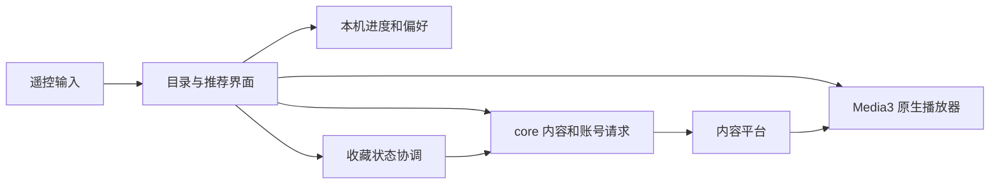

# 架构与关键实现

## 工程结构

```text
android/
  app/     Android原生界面、遥控、Media3播放、账号状态落盘
  core/    Kotlin/JVM内容模型、网络/账号协议、状态策略与单元测试
docs/
  miniact/ 当前产品/设计/构建/验证说明
  screenshots/ 实拍与来源
  upstream/ 上游发布配置参考（不激活）
tools/     构建工具及继承的研究/维护工具
```



客户端没有配套MiniAct自建内容服务器。它不是把官网页面作为主播放器的WebView壳，内容、登录与媒体能力主要沿用HGTV原生实现。

## 关键文件

以下名称均位于`android/app/src/main/kotlin/com/hgtv/star/`，除注明外：

| 文件或目录 | 责任 |
| --- | --- |
| MainActivity及扩展文件 | 页面、输入、生命周期和功能接线 |
| MiniActNavigation / MiniActSettings | 固定导航、设置分组及焦点恢复 |
| list/MiniActHomeFeed | 纵向栏目与横向列表回收，位置恢复 |
| tv/MiniActFeature | 精选布局与有限尺寸海报合成 |
| tv/MiniActTheme / MiniActGlass | 主题偏好、共享场景与玻璃绘制 |
| MiniActRecommendation | 推荐与正式追剧边界 |
| MainActivityPlayback / architecture/PlaybackController | 播放准备、预热、连播与错误恢复 |
| player/MiniActPlaybackPanel / MiniActEpisodePicker | 右侧播放设置与选集 |
| MiniActFavorites / core的FavoriteSync | 固定账号会话、写入与回读确认 |
| data/ArtworkLoader / ArtworkCache | 图片采样、内存/磁盘缓存及并发 |
| data/PlaybackCapability | 系统解码能力与默认清晰度策略 |
| data/SessionMirror / AppSessionStore | 本机私有目录会话落盘 |

## 值得保留的工程决策

1. 推荐上下换剧，正式追剧上下切集；切模式前后必须保持当前剧身份，不执行旧加载回调的追剧意图。
2. 收藏只在写入并回读确认后完成；固定本次账号会话，过滤换号后的迟到回调，避免旧刷新覆盖新操作。
3. 浏览、详情、播放器的场景隔离；共享玻璃纹理不等于共享剧目状态。
4. 首页回收列表、缓存文字和小图，滚动中延后刷新；焦点不触发布局缩放。
5. 手动选档不被低配默认策略悄悄覆盖；自动恢复有预算和明确失败反馈。
6. 会话、偏好、观看进度和收藏各自有所有权；改视觉时不清空用户数据。

## 维护注意

部分继承注释与docs旧文档仍描述HGTV公共目录镜像等历史方案；当前`SessionMirror.dirs()`只返回应用私有files目录。阅读实现优先于旧注释。namespace仍为`com.hgtv.star`，applicationId独立为`dev.miniact.nativeapp`，两者不同属正常继承关系。不要把全局改包名作为纯文案修改。
